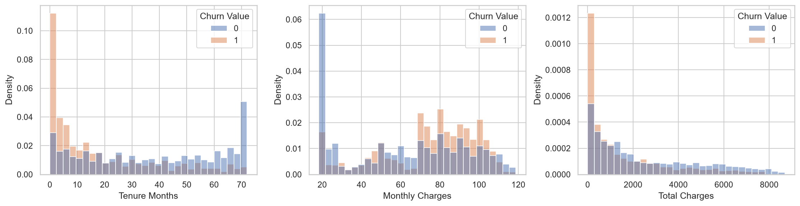
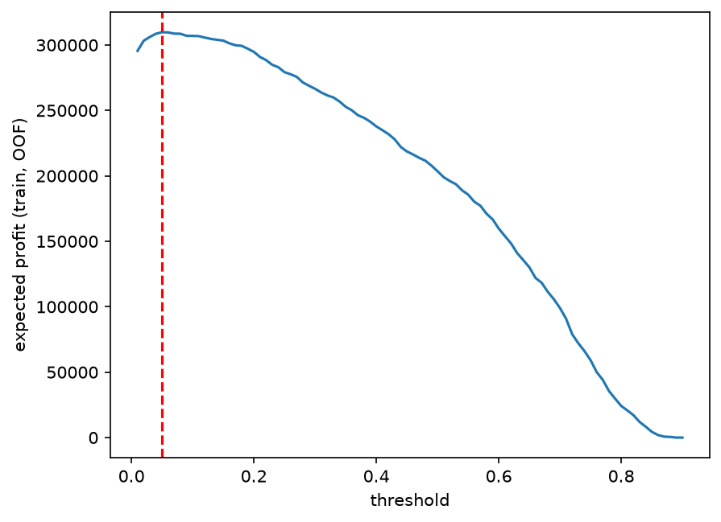
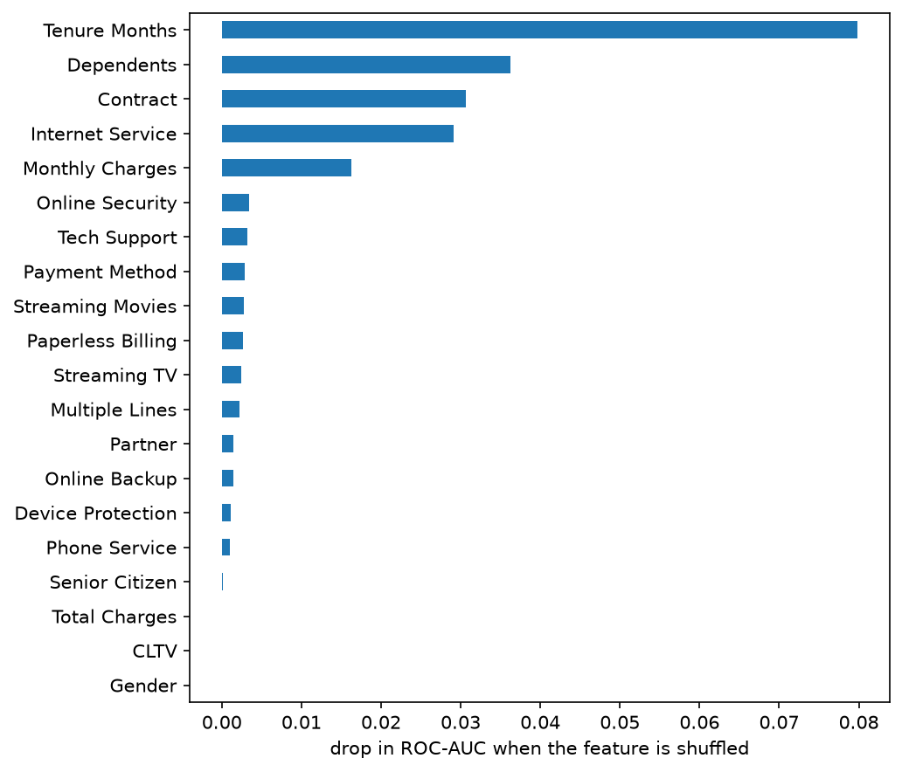

# Customer Churn Prediction

Predicting which telecom customers are about to leave, and choosing who should get a retention offer based on business cost. Classical ML (logistic regression, Random Forest, XGBoost) and a PyTorch MLP, a decision threshold chosen by expected profit, and an A/B test design.

**Result in one line:** all models reach about 0.86 ROC-AUC in cross-validation and are equal within noise, so the simplest one (logistic regression) is kept; choosing the threshold by cost gives a simulated profit about 9.5% above contacting everyone.

## Business problem

- **Who has the problem:** the retention team of a telecom operator.
- **Why it matters:** every customer who leaves is lost revenue, while a retention offer costs money. Contacting everyone is too expensive, contacting nobody loses customers.
- **Decision the model supports:** which customers get a retention offer.
- **Cost assumptions (simulated, not from real data):** loss if a customer leaves 890, cost of one offer 20, share of at-risk customers saved by an offer 30%. They are used only to choose the threshold and estimate the effect, and they are varied in a sensitivity analysis.

## Data

- **Source:** IBM Telco Customer Churn (extended version) from [Kaggle](https://www.kaggle.com/datasets/yeanzc/telco-customer-churn-ibm-dataset). The data is not stored in the repository; see [data/README.md](data/README.md) for how to get it and for the license note.
- **Size:** 7043 customers, 33 columns in the raw file, 21 after cleaning.
- **Target:** `Churn Value` (1 = left), 26.5% of customers churned. Accuracy is not a useful metric: always predicting "stayed" already gives about 73%.
- **Data issues handled:** 11 blank `Total Charges` values (new customers with tenure 0, set to 0); leakage columns removed (`Churn Label`, `Churn Score` from another IBM model, `Churn Reason` known only after churn); constants and a duplicate column dropped; geography dropped (1-5 customers per zip code); `CLTV` and `Total Charges` kept out of the model input.



Churned customers have a shorter tenure (median 10 vs 38 months) and pay more per month (median 79.6 vs 64.4). Month-to-month contracts, fiber optic and electronic checks have the highest churn rates.

## Approach

- **Validation:** stratified 80/20 train/test split (seed 42), 5-fold stratified cross-validation on train for every model, test set used once at the end.
- **Baselines:** a dummy classifier and logistic regression.
- **Models:** Random Forest and XGBoost tuned with `RandomizedSearchCV` (30 iterations), and a PyTorch MLP (two hidden layers, dropout, weight decay, early stopping).
- **Preprocessing:** a scikit-learn `ColumnTransformer` fitted only on the training part of each fold: scaling for numeric features, one-hot encoding for categorical ones.
- **Metrics:** ROC-AUC to compare models (does not depend on the threshold), recall and precision to see the trade-off, expected profit to make the decision.
- **Threshold:** chosen by expected profit on out-of-fold predictions of train, not on the test set. The break-even point is c / (p x V) = 20 / (0.3 x 890), about 0.075.
- **Interpretation:** logistic regression coefficients and permutation importance. SHAP was not used.
- **A/B test design:** randomized 50/50 split of flagged customers, two-sided test of two proportions (alpha 0.05, power 0.8), decision rule based on the break-even effect. Design only, no experiment was run.

## Results

**Model comparison** (ROC-AUC, 5-fold cross-validation on train):

| Model | ROC-AUC |
| --- | --- |
| Dummy classifier | 0.500 |
| Logistic regression | 0.858 |
| MLP (not tuned) | 0.857 |
| Random Forest (tuned) | 0.861 |
| XGBoost (tuned) | 0.865 |

The differences between the real models are smaller than the fold-to-fold spread (about 0.012), so no complex model is clearly better. Logistic regression is kept: simplest, explainable, equal quality. On the held-out test set it reaches ROC-AUC 0.847.

**Business effect (simulated).** With threshold 0.05 the model contacts 71% of test customers (recall 0.987, precision 0.369). Expected profit per 1000 customers:

| Strategy | Profit |
| --- | --- |
| Contact nobody | 0 |
| Contact everyone | 50 872 |
| Model, threshold 0.05 | 55 730 |



The value of the model depends on the cost of the offer: its gain over the best simple strategy grows when the offer is expensive and is small when the offer is cheap (sensitivity table in `notebooks/03_threshold_business.ipynb`).

**What drives churn.** Five features carry almost all the signal: tenure, dependents, contract type, internet service and monthly charges.



**Limitations**
- All money values come from three assumed numbers, not from a real campaign. The true save rate can only be measured with an A/B test.
- The test set has 1409 customers: a single noisy estimate without a confidence interval.
- Drivers are associations in a static dataset, not causes. Coefficients are effects given all other features and can look counter-intuitive.
- Detecting only the break-even effect in an A/B test would need about 7000 customers per group, more than this dataset.

## Takeaway

- On this dataset a simple, explainable model is as good as tuned trees and a neural network. The gains come from choosing the decision threshold by business cost, not from a more complex model.
- The usefulness of the model depends strongly on the cost of the offer, so the cost assumptions should be validated first.
- Next step: serve the model through an API and monitor drift (Project 3).

## How to run

Requires [uv](https://docs.astral.sh/uv/) and Python 3.13.

```bash
uv sync
```

1. Download the dataset and convert it to CSV as described in [data/README.md](data/README.md) (it must end up in `data/raw/Telco_customer_churn.csv`).
2. Open the notebooks in `notebooks/` and run them in order (a fixed seed, `SEED = 42` in `src/churn/config.py`, makes the results reproducible):

| Notebook | Content |
| --- | --- |
| `01_eda.ipynb` | data checks, cleaning, EDA |
| `02_modeling.ipynb` | baselines, tuned trees, MLP, cross-validation |
| `03_threshold_business.ipynb` | threshold by business cost, sensitivity, test evaluation |
| `04_interpretation.ipynb` | coefficients and permutation importance |
| `05_ab_test_design.ipynb` | sample size for the A/B test |

## Project structure

```
data/           dataset description (the data itself is not committed)
docs/           project brief, experiment log, work plan, git workflow
notebooks/      the five notebooks above
reports/figures figures used in this README
src/churn/      config, data loading and cleaning, preprocessing pipeline, MLP, profit function
```

Detailed plan and decisions: [docs/01_Project_Brief.md](docs/01_Project_Brief.md). Every experiment: [docs/02_Experiment_Log.md](docs/02_Experiment_Log.md).
